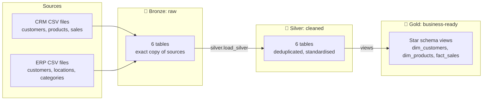
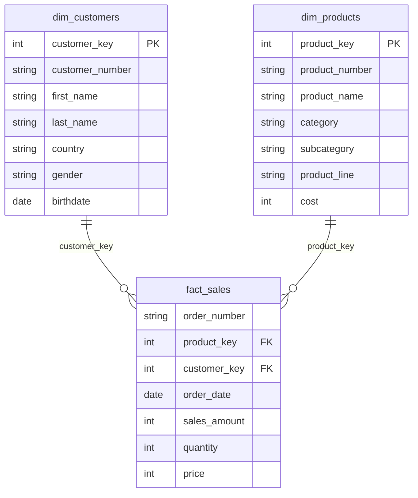

# SQL Data Warehouse Project

A modern data warehouse built with **SQL Server**, consolidating sales data from two source systems (**CRM** and **ERP**) into a clean, business-ready **star schema** using the **Medallion Architecture** (Bronze → Silver → Gold).

Built on **macOS (Apple Silicon)** with SQL Server running in **Docker**.

---

## 🏗️ Data Architecture



| Layer | Purpose | Object type | Load |
|---|---|---|---|
| **Bronze** | Raw data loaded as-is from CSV files | Tables | `EXEC bronze.load_bronze` (truncate + `BULK INSERT`) |
| **Silver** | Cleaned, standardised, joinable data | Tables | `EXEC silver.load_silver` (truncate + `INSERT … SELECT`) |
| **Gold** | Business-ready star schema | Views | None: always reflects Silver |

---

## ⭐ Data Model (Gold)



Full column descriptions: [docs/data_catalog.md](docs/data_catalog.md)

---

## 🧹 Data Quality & Transformations (Silver)

| Table | Issues found | Fix |
|---|---|---|
| `crm_cust_info` | Duplicate and NULL customer IDs, extra spaces, coded values | Keep latest record (`ROW_NUMBER`), `TRIM`, codes → `Married`/`Single`, `Male`/`Female` |
| `crm_prd_info` | Combined key, NULL costs, coded product lines, 200 end dates before start dates | Split key into `cat_id` + `prd_key`, `ISNULL`, readable lines, end date = next start − 1 day (`LEAD`) |
| `crm_sales_details` | Dates stored as integers (some invalid), sales ≠ quantity × price | Convert to `DATE` (invalid → NULL), recalculate sales and price |
| `erp_cust_az12` | `NAS` ID prefix, future birthdates, inconsistent gender | Strip prefix, future dates → NULL, standardise gender |
| `erp_loc_a101` | Dashes in IDs, inconsistent country names | Remove dashes, `DE`/`US`/`USA` → full names, blanks → `n/a` |
| `erp_px_cat_g1v2` | None | Loaded as-is |

Each rule is backed by a check in [`tests/`](tests/), including after-load verification and Gold referential-integrity checks.

---

## 📂 Repository Structure

```
sql-data-warehouse-project/
├── datasets/
│   ├── source_crm/            # cust_info, prd_info, sales_details
│   └── source_erp/            # CUST_AZ12, LOC_A101, PX_CAT_G1V2
├── docs/
│   ├── data_catalog.md        # Gold layer column descriptions
│   └── naming_conventions.md
├── scripts/
│   ├── init_database.sql      # Create DataWarehouse database and schemas
│   ├── bronze/                # Bronze tables + load procedure
│   ├── silver/                # Silver tables, per-table cleaning, load procedure
│   └── gold/                  # Star schema views
├── tests/                     # Data quality checks, one file per table + Gold
└── README.md
```

---

## 🛠️ Tech Stack

- **SQL Server 2022** (Developer Edition) in **Docker** on macOS (Apple Silicon, via Rosetta)
- **T-SQL**: stored procedures, window functions (`ROW_NUMBER`, `LEAD`), `BULK INSERT`, views
- **VS Code** with the **MSSQL extension**
- **Git & GitHub**

---

## 🚀 How to Run (macOS)

1. Install [Docker Desktop](https://www.docker.com/products/docker-desktop/) and Rosetta.
2. Create a `.env` file in the project root (never committed):
   ```
   ACCEPT_EULA=Y
   MSSQL_SA_PASSWORD=<your-strong-password>
   ```
3. Start SQL Server with the datasets mounted:
   ```bash
   docker run -d --name sql-dwh --platform linux/amd64 --env-file .env \
     -p 1433:1433 -v sqldwh-data:/var/opt/mssql \
     -v "$(pwd)/datasets:/datasets:ro" --restart unless-stopped \
     mcr.microsoft.com/mssql/server:2022-latest
   ```
4. Run the scripts in order:
   ```
   scripts/init_database.sql
   scripts/bronze/ddl_bronze.sql      → scripts/bronze/proc_load_bronze.sql → EXEC bronze.load_bronze;
   scripts/silver/ddl_silver.sql      → scripts/silver/proc_load_silver.sql → EXEC silver.load_silver;
   scripts/gold/ddl_gold.sql
   ```
5. Query the Gold layer:
   ```sql
   SELECT c.country, SUM(f.sales_amount) AS total_sales
   FROM gold.fact_sales f
   JOIN gold.dim_customers c ON f.customer_key = c.customer_key
   GROUP BY c.country
   ORDER BY total_sales DESC;
   ```

### macOS / Docker notes
- SQL Server runs in a Linux container, so `BULK INSERT` uses container paths (`/datasets/...`) instead of Windows paths.
- The CSV files use Windows line endings; `ROWTERMINATOR = '0x0d0a'` prevents a hidden `\r` from being stored in the last column of every row.

---

## 🙏 Acknowledgements

Based on the [SQL Data Warehouse project](https://youtu.be/9GVqKuTVANE) by Data with Baraa, adapted for macOS.

## 👩‍💻 Author

**Manasi Patil**: [GitHub](https://github.com/Manasipatil23)
